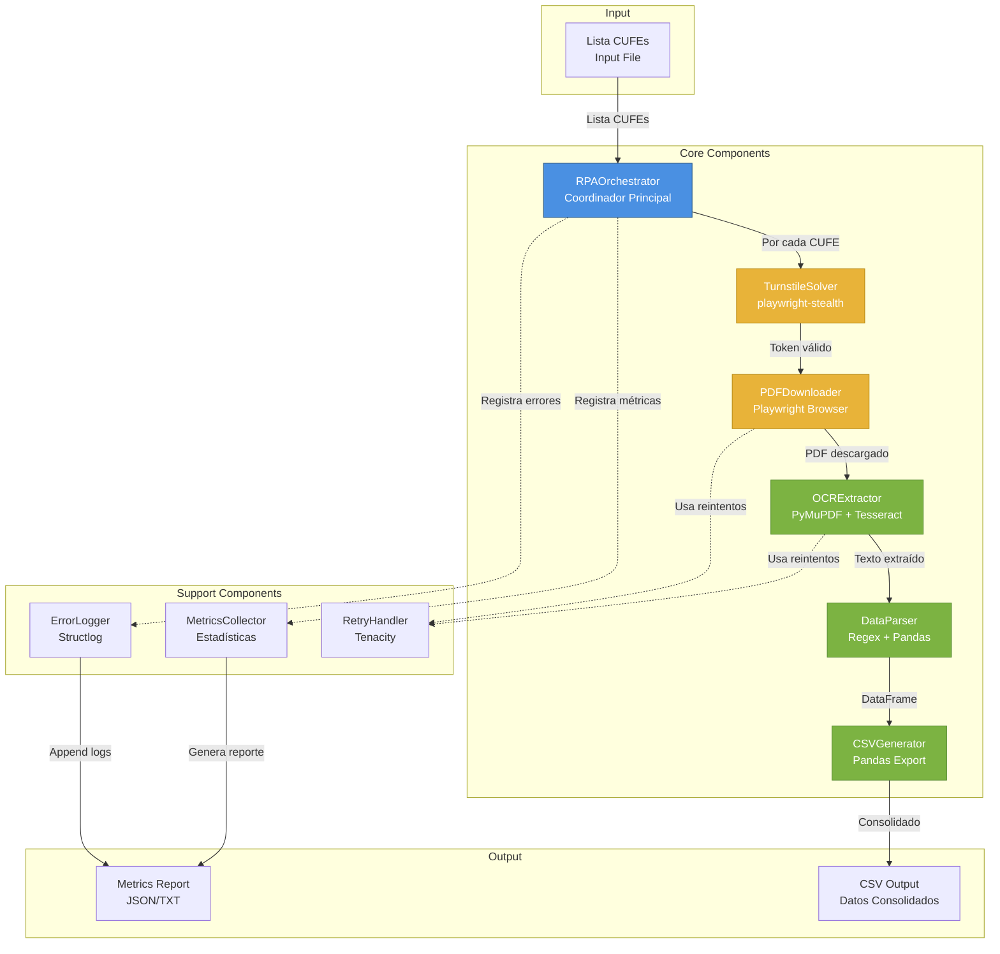

# Diseño Técnico: Sistema RPA CUFE DIAN

## Overview

El sistema RPA CUFE DIAN es una aplicación Python modular que automatiza la consulta, descarga y extracción de datos de facturas electrónicas desde el portal de validación de la DIAN. El sistema está diseñado con componentes claramente separados que permiten el aprendizaje progresivo y el mantenimiento independiente de cada funcionalidad.

### Arquitectura General

El sistema sigue una arquitectura de pipeline con cinco componentes principales que procesan datos secuencialmente:

```
Input (Lista CUFEs) 
    → CAPTCHA Solver (Cloudflare Turnstile)
    → PDF Downloader (Navegación y descarga)
    → OCR Extractor (Extracción de texto)
    → Data Parser (Estructuración de datos)
    → CSV Generator (Exportación)
    → Output (CSV + Métricas)
```

### Tecnologías Principales

- **Lenguaje**: Python 3.10+
- **Automatización Web**: Playwright (recomendado sobre Selenium por mejor rendimiento con Cloudflare)
- **Resolución Turnstile**: playwright-stealth (sin costo)
- **Extracción OCR**: PyMuPDF + pypdf (desbloqueo) + Tesseract (pytesseract)
- **Procesamiento de Datos**: Pandas
- **Manejo de Reintentos**: Tenacity
- **Logging**: Python logging (estándar) + structlog (estructurado)

### Justificación de Librerías

**Playwright vs Selenium**: Playwright utiliza Chrome DevTools Protocol (CDP) que permite control directo del navegador, resultando en mejor rendimiento y menos detección por sistemas anti-bot como Cloudflare. Además, tiene auto-wait incorporado que reduce errores de timing.

**PyMuPDF + pypdf + Tesseract**: PyMuPDF es la librería más rápida para extracción de texto nativo de PDFs (licencia AGPL para uso no comercial). pypdf se usa para desbloquear PDFs protegidos con contraseña (los PDFs de DIAN requieren el NIT como contraseña). Para facturas escaneadas o con texto en imagen, Tesseract proporciona OCR confiable mantenido por Google con soporte para español.

**Tenacity**: Librería estándar de la industria para manejo de reintentos con backoff exponencial, más limpia y mantenible que implementaciones custom.

## Architecture

### Diagrama de Componentes



### Flujo de Datos

1. **Entrada**: Lista de CUFEs (archivo TXT o CSV)
2. **Orquestación**: RPAOrchestrator procesa cada CUFE secuencialmente
3. **Resolución CAPTCHA**: CAPTCHASolver obtiene token válido de Turnstile
4. **Descarga PDF**: PDFDownloader navega portal DIAN con token y descarga PDF
5. **Extracción OCR**: OCRExtractor extrae texto del PDF (nativo o escaneado)
6. **Parsing**: DataParser identifica campos específicos usando regex
7. **Consolidación**: CSVGenerator acumula todos los DataFrames
8. **Salida**: CSV consolidado + reporte de métricas

### Separación de Responsabilidades

Cada componente tiene una responsabilidad única y bien definida:

- **RPAOrchestrator**: Coordina el flujo, no contiene lógica de negocio
- **CAPTCHASolver**: Solo maneja Cloudflare Turnstile
- **PDFDownloader**: Solo navegación y descarga
- **OCRExtractor**: Solo extracción de texto
- **DataParser**: Solo identificación y estructuración de campos
- **CSVGenerator**: Solo exportación de datos

## Components and Interfaces

### 1. RPAOrchestrator

**Responsabilidad**: Coordinar el pipeline completo y gestionar el ciclo de vida de todos los componentes.

**Interfaz**:
```python
class RPAOrchestrator:
    def __init__(self, config: Dict[str, Any]):
        """
        Args:
            config: Diccionario con configuración:
                - input_file: ruta al archivo con lista de CUFEs
                - output_dir: directorio para PDFs y CSV
                - nit_prueba: NIT para consultas
                - max_workers: workers concurrentes (default: 1)
        """
        
    def run(self) -> Dict[str, Any]:
        """
        Ejecuta el pipeline completo.
        
        Returns:
            Dict con métricas finales:
            {
                'total_cufes': int,
                'successful_downloads': int,
                'failed_downloads': int,
                'successful_extractions': int,
                'failed_extractions': int,
                'total_time_seconds': float,
                'csv_output_path': str
            }
        """
        
    def _process_single_cufe(self, cufe: str) -> ProcessResult:
        """Procesa un CUFE individual a través del pipeline."""
```

**Dependencias**: TurnstileSolver, PDFDownloader, OCRExtractor, DataParser, CSVGenerator, MetricsCollector

### 2. TurnstileSolver

**Responsabilidad**: Resolver desafíos de Cloudflare Turnstile usando técnicas de evasión de detección sin servicios de pago.

**Librería Principal**: playwright-stealth

**Enfoque**: En lugar de usar servicios de pago que resuelven el CAPTCHA, este componente usa playwright-stealth para evitar detección de bots y espera a que Cloudflare Turnstile se resuelva automáticamente (modo pasivo).

**Ventajas**:
- ✅ Sin costo
- ✅ No requiere API keys ni servicios externos
- ✅ Fácil implementación y mantenimiento

**Desventajas**:
- ⚠️ Tasa de éxito menor (70-85% vs 95%+ de servicios de pago)
- ⚠️ Más lento (30-60 segundos vs 10-15 segundos)
- ⚠️ Puede requerir ajustes si Cloudflare actualiza detección

**Interfaz**:
```python
class TurnstileSolver:
    def __init__(self, timeout: int = 60):
        """
        Args:
            timeout: Tiempo máximo de espera en segundos (default: 60)
        """
        
    def solve_turnstile(self, page) -> bool:
        """
        Espera a que Cloudflare Turnstile se resuelva automáticamente.
        Usa playwright-stealth para evasión de detección.
        
        Args:
            page: Instancia de Page de Playwright ya navegada al portal DIAN
            
        Returns:
            True si se resolvió exitosamente, False si timeout
            
        Raises:
            TurnstileSolveError: Si ocurre un error inesperado
        """
        
    def get_success_rate(self) -> float:
        """Retorna tasa de éxito de resoluciones (0.0-1.0)."""
        
    def _simulate_human_behavior(self, page):
        """Simula movimientos de mouse y delays aleatorios."""
```

**Implementación Sugerida**:
```python
from playwright.sync_api import Page
from playwright_stealth import stealth_sync
import time
import random

class TurnstileSolver:
    def __init__(self, timeout: int = 60):
        self.timeout = timeout
        self.successful_solves = 0
        self.failed_solves = 0
        
    def solve_turnstile(self, page: Page) -> bool:
        """
        Espera a que Turnstile se resuelva automáticamente.
        
        Estrategia:
        1. Detectar iframe de Turnstile
        2. Simular comportamiento humano (movimientos de mouse, delays)
        3. Esperar a que el token cf-turnstile-response se genere
        4. Verificar que el token es válido (longitud > 0)
        """
        try:
            # Detectar si hay un iframe de Turnstile
            turnstile_iframe = page.query_selector('iframe[src*="challenges.cloudflare.com"]')
            
            if not turnstile_iframe:
                # No hay Turnstile, continuar directamente
                self.successful_solves += 1
                return True
            
            # Simular comportamiento humano
            self._simulate_human_behavior(page)
            
            # Esperar a que Turnstile se resuelva automáticamente
            # Verificar que el token cf-turnstile-response se haya generado
            page.wait_for_function(
                """() => {
                    const response = document.querySelector('[name="cf-turnstile-response"]');
                    if (!response) return false;
                    
                    // Verificar que el token tiene contenido
                    const token = response.value || response.getAttribute('value');
                    return token && token.length > 0;
                }""",
                timeout=self.timeout * 1000
            )
            
            # Delay adicional para asegurar que el token es estable
            time.sleep(random.uniform(1, 2))
            
            self.successful_solves += 1
            return True
            
        except Exception as e:
            self.failed_solves += 1
            logger.error("turnstile_solve_failed", error=str(e))
            return False
    
    def _simulate_human_behavior(self, page: Page):
        """
        Simula comportamiento humano para evitar detección.
        
        Técnicas:
        - Movimientos aleatorios del mouse
        - Delays variables entre acciones
        - Scroll ocasional
        """
        # Movimientos aleatorios del mouse
        for _ in range(random.randint(3, 5)):
            x = random.randint(100, 800)
            y = random.randint(100, 600)
            page.mouse.move(x, y)
            time.sleep(random.uniform(0.1, 0.3))
        
        # Scroll aleatorio (simular que el usuario está leyendo)
        if random.random() > 0.5:
            page.mouse.wheel(0, random.randint(100, 300))
            time.sleep(random.uniform(0.5, 1))
        
        # Delay principal (esperar como un humano)
        time.sleep(random.uniform(2, 4))
    
    def get_success_rate(self) -> float:
        """Calcula la tasa de éxito de resoluciones."""
        total = self.successful_solves + self.failed_solves
        if total == 0:
            return 0.0
        return self.successful_solves / total
```

**Configuración Adicional**:

El uso de playwright-stealth requiere aplicarlo a cada página del navegador:

```python
from playwright.sync_api import sync_playwright
from playwright_stealth import stealth_sync

playwright = sync_playwright().start()
browser = playwright.chromium.launch(
    headless=False,  # Recomendado: usar headless=False para mejor tasa de éxito
    args=[
        '--disable-blink-features=AutomationControlled',
        '--disable-dev-shm-usage',
        '--no-sandbox'
    ]
)

context = browser.new_context(
    viewport={'width': 1920, 'height': 1080},
    user_agent='Mozilla/5.0 (Windows NT 10.0; Win64; x64) AppleWebKit/537.36 (KHTML, like Gecko) Chrome/120.0.0.0 Safari/537.36'
)

page = context.new_page()

# Aplicar playwright-stealth
stealth_sync(page)
```

**Instalación**:
```bash
pip install playwright playwright-stealth
playwright install chromium
```

**Notas de Implementación**:
- **Modo headless**: Usar `headless=False` aumenta la tasa de éxito (80-85% vs 70-75%)
- **User-Agent**: Usar un User-Agent actualizado de Chrome/Edge
- **Viewport**: Usar resolución realista (1920x1080 o 1366x768)
- **Timeout**: 60 segundos es recomendado (Turnstile puede tardar 20-40 segundos)
- **Reintentos**: Si falla, reintentar con una nueva sesión del navegador

### 3. PDFDownloader

**Responsabilidad**: Navegar el portal DIAN, ingresar CUFE, resolver Turnstile con técnicas de evasión, y descargar PDF.

**Librería Principal**: Playwright + playwright-stealth

**Interfaz**:
```python
class PDFDownloader:
    def __init__(self, 
                 turnstile_solver: TurnstileSolver,
                 download_dir: str,
                 headless: bool = False):
        """
        Args:
            turnstile_solver: Instancia de TurnstileSolver
            download_dir: Directorio para PDFs descargados
            headless: Ejecutar navegador sin interfaz gráfica 
                     (Nota: headless=False mejora tasa de éxito de Turnstile)
        """
        
    @retry(
        stop=stop_after_attempt(3),
        wait=wait_exponential(multiplier=1, min=2, max=10),
        retry=retry_if_exception_type(NetworkError)
    )
    def download_pdf(self, cufe: str, nit: str) -> str:
        """
        Descarga PDF para un CUFE específico.
        
        Args:
            cufe: Código CUFE de la factura
            nit: NIT del emisor
            
        Returns:
            Ruta completa al PDF descargado
            
        Raises:
            DownloadError: Si falla después de reintentos
            InvalidCUFEError: Si CUFE no existe
            TurnstileSolveError: Si Turnstile no se resuelve después de timeout
        """
        
    def close(self):
        """Cierra el navegador y libera recursos."""
```

**Implementación Clave**:
```python
from playwright.sync_api import sync_playwright, Page
from playwright_stealth import stealth_sync
from tenacity import retry, stop_after_attempt, wait_exponential

class PDFDownloader:
    def __init__(self, turnstile_solver: TurnstileSolver, 
                 download_dir: str, headless: bool = False):
        self.turnstile_solver = turnstile_solver
        self.download_dir = download_dir
        self.headless = headless
        self.playwright = None
        self.browser = None
        self.context = None
        
    def _init_browser(self):
        """Inicializa Playwright y navegador con configuración anti-detección."""
        self.playwright = sync_playwright().start()
        
        # Configuración del navegador para evasión de detección
        self.browser = self.playwright.chromium.launch(
            headless=self.headless,  # Recomendado: False para mejor tasa de éxito
            args=[
                '--disable-blink-features=AutomationControlled',
                '--disable-dev-shm-usage',
                '--no-sandbox',
                '--disable-setuid-sandbox',
                '--disable-web-security'
            ]
        )
        
        # Contexto con User-Agent realista y viewport
        self.context = self.browser.new_context(
            viewport={'width': 1920, 'height': 1080},
            user_agent='Mozilla/5.0 (Windows NT 10.0; Win64; x64) AppleWebKit/537.36 (KHTML, like Gecko) Chrome/120.0.0.0 Safari/537.36',
            locale='es-CO',
            timezone_id='America/Bogota'
        )
        
    @retry(
        stop=stop_after_attempt(3),
        wait=wait_exponential(multiplier=1, min=2, max=10)
    )
    def download_pdf(self, cufe: str, nit: str) -> str:
        if not self.browser:
            self._init_browser()
            
        page = self.context.new_page()
        
        # Aplicar playwright-stealth para evasión de detección
        stealth_sync(page)
        
        try:
            # 1. Navegar a portal DIAN
            page.goto(
                "https://catalogo-vpfe.dian.gov.co/User/SearchDocument",
                wait_until="networkidle",
                timeout=30000
            )
            
            # 2. Resolver primer Cloudflare Turnstile (si está presente en página inicial)
            turnstile_resolved = self.turnstile_solver.solve_turnstile(page)
            
            if not turnstile_resolved:
                raise TurnstileSolveError(
                    f"Primer Turnstile no se resolvió después de {self.turnstile_solver.timeout}s"
                )
            
            # 3. Llenar formulario con CUFE y NIT
            page.fill('input[name="DocumentKey"]', cufe)
            page.fill('input[name="PartitionKey"]', nit)
            
            # 4. Enviar formulario
            page.click('button[type="submit"]')
            page.wait_for_load_state("networkidle", timeout=30000)
            
            # 5. Resolver segundo Turnstile en página de detalle (si está presente)
            second_turnstile_resolved = self.turnstile_solver.solve_turnstile(page)
            
            if not second_turnstile_resolved:
                raise TurnstileSolveError(
                    f"Segundo Turnstile no se resolvió después de {self.turnstile_solver.timeout}s"
                )
            
            # 6. Verificar si CUFE es válido
            page_content = page.content()
            if "No se encontraron resultados" in page_content or "No se encontró" in page_content:
                raise InvalidCUFEError(f"CUFE {cufe} no existe en el sistema DIAN")
            
            # 7. Click en botón de descarga PDF
            with page.expect_download(timeout=60000) as download_info:
                page.click('a[href*="DownloadPDF"]')
            
            download = download_info.value
            
            # 8. Guardar con nombre único
            pdf_path = f"{self.download_dir}/{cufe}.pdf"
            download.save_as(pdf_path)
            
            logger.info("pdf_downloaded", cufe=cufe, path=pdf_path)
            
            return pdf_path
            
        finally:
            page.close()
    
    def close(self):
        """Cierra el navegador y libera recursos."""
        if self.context:
            self.context.close()
        if self.browser:
            self.browser.close()
        if self.playwright:
            self.playwright.stop()
```

**Configuración Playwright**:
```bash
# Instalación
pip install playwright playwright-stealth
playwright install chromium
```

**Recomendaciones de Configuración**:

1. **Modo Headless**:
   - `headless=False` → Tasa de éxito: 80-85%
   - `headless=True` → Tasa de éxito: 70-75%
   - Recomendación: Usar `headless=False` en desarrollo y producción si es posible

2. **User-Agent**:
   - Usar un User-Agent actualizado de Chrome en Windows
   - Actualizar periódicamente (cada 3-6 meses)

3. **Viewport**:
   - Usar resoluciones comunes: 1920x1080, 1366x768, 1536x864
   - Evitar resoluciones inusuales que delatan automatización

4. **Locale y Timezone**:
   - Configurar locale='es-CO' (español de Colombia)
   - Configurar timezone_id='America/Bogota'

**Manejo de Errores**:
- NetworkError → Reintentar con backoff exponencial (máx 3 intentos)
- InvalidCUFEError → No reintentar, registrar y continuar
- TurnstileSolveError → Reintentar (puede ser temporal)
- TimeoutError → Reintentar (puede ser congestión temporal)

### 4. OCRExtractor

**Responsabilidad**: Extraer texto de PDFs usando extracción nativa o OCR cuando sea necesario.

**Librerías**: PyMuPDF (fitz) + pytesseract

**Interfaz**:
```python
class OCRExtractor:
    def __init__(self, tesseract_path: Optional[str] = None):
        """
        Args:
            tesseract_path: Ruta al ejecutable de Tesseract
                           (None = usar PATH del sistema)
        """
        
    @retry(
        stop=stop_after_attempt(2),
        wait=wait_fixed(3)
    )
    def extract_text(self, pdf_path: str, nit: Optional[str] = None) -> str:
        """
        Extrae texto de un PDF.
        Verifica si está protegido y lo desbloquea con NIT si es necesario.
        Intenta primero extracción nativa, fallback a OCR si falla.
        
        Args:
            pdf_path: Ruta al archivo PDF
            nit: NIT para desbloquear PDF si está protegido con contraseña
            
        Returns:
            Texto completo extraído del PDF
            
        Raises:
            ExtractionError: Si el PDF no puede ser desbloqueado o ambos métodos fallan
        """
    
    def _unlock_pdf(self, pdf_path: str, nit: str) -> str:
        """Desbloquea PDF protegido con contraseña y retorna ruta al PDF desbloqueado."""
        
    def _extract_native(self, pdf_path: str) -> str:
        """Extrae texto nativo del PDF usando PyMuPDF."""
        
    def _extract_ocr(self, pdf_path: str) -> str:
        """Extrae texto usando OCR (Tesseract) para PDFs escaneados."""
```

**Implementación**:
```python
import fitz  # PyMuPDF
import pytesseract
from PIL import Image
import io
from tenacity import retry, stop_after_attempt, wait_fixed

class OCRExtractor:
    def __init__(self, tesseract_path: Optional[str] = None):
        if tesseract_path:
            pytesseract.pytesseract.tesseract_cmd = tesseract_path
        self.native_success = 0
        self.ocr_fallback = 0
        self.unlocked_pdfs = 0
        
    @retry(stop=stop_after_attempt(2), wait=wait_fixed(3))
    def extract_text(self, pdf_path: str, nit: Optional[str] = None) -> str:
        working_pdf_path = pdf_path
        
        # 1. Verificar si el PDF está protegido con contraseña
        try:
            from pypdf import PdfReader
            reader = PdfReader(pdf_path)
            if reader.is_encrypted:
                if not nit:
                    raise ExtractionError("PDF protegido con contraseña pero no se proporcionó NIT")
                # Desbloquear PDF con NIT
                working_pdf_path = self._unlock_pdf(pdf_path, nit)
                self.unlocked_pdfs += 1
                logger.info("pdf_unlocked", pdf=pdf_path, nit_used=nit)
        except Exception as e:
            logger.warning("unlock_check_failed", error=str(e))
        
        # 2. Intentar extracción nativa primero
        try:
            text = self._extract_native(working_pdf_path)
            if len(text.strip()) > 50:  # Validar que hay texto suficiente
                self.native_success += 1
                return text
        except Exception as e:
            logger.debug(f"Extracción nativa falló: {e}")
        
        # 3. Fallback a OCR
        try:
            text = self._extract_ocr(working_pdf_path)
            self.ocr_fallback += 1
            return text
        except Exception as e:
            raise ExtractionError(f"Ambos métodos fallaron: {e}")
    
    def _unlock_pdf(self, pdf_path: str, nit: str) -> str:
        """
        Desbloquea PDF protegido con contraseña usando pypdf.
        Retorna la ruta al PDF desbloqueado.
        """
        from pypdf import PdfReader, PdfWriter
        import os
        
        reader = PdfReader(pdf_path)
        
        # Intentar desbloquear con el NIT
        if not reader.decrypt(nit):
            raise ExtractionError(f"No se pudo desbloquear PDF con NIT proporcionado: {nit}")
        
        # Crear nuevo PDF desbloqueado
        writer = PdfWriter()
        for page in reader.pages:
            writer.add_page(page)
        
        # Guardar PDF desbloqueado
        unlocked_path = pdf_path.replace('.pdf', '_unlocked.pdf')
        with open(unlocked_path, 'wb') as output_file:
            writer.write(output_file)
        
        return unlocked_path
    
    def _extract_native(self, pdf_path: str) -> str:
        """Extrae texto nativo del PDF."""
        doc = fitz.open(pdf_path)
        text = ""
        for page in doc:
            text += page.get_text()
        doc.close()
        return text
    
    def _extract_ocr(self, pdf_path: str) -> str:
        """Extrae texto usando OCR."""
        doc = fitz.open(pdf_path)
        text = ""
        
        for page_num in range(len(doc)):
            page = doc[page_num]
            
            # Convertir página a imagen
            pix = page.get_pixmap(matrix=fitz.Matrix(2, 2))  # 2x zoom
            img = Image.open(io.BytesIO(pix.tobytes()))
            
            # OCR con Tesseract (configurado para español)
            page_text = pytesseract.image_to_string(
                img, 
                lang='spa',
                config='--psm 6'  # Assume uniform block of text
            )
            text += page_text + "\n"
        
        doc.close()
        return text
```

**Instalación de Tesseract**:
```bash
# Windows
# Descargar instalador desde: https://github.com/UB-Mannheim/tesseract/wiki
# Agregar al PATH o especificar ruta en constructor

# Linux
sudo apt-get install tesseract-ocr tesseract-ocr-spa

# MacOS
brew install tesseract tesseract-lang
```

**Configuración de Idioma**:
- Tesseract debe tener el paquete de idioma español instalado (`spa.traineddata`)
- PyMuPDF no requiere configuración de idioma (extracción directa)

### 5. DataParser

**Responsabilidad**: Identificar y extraer campos específicos del texto de la factura usando patrones regex.

**Librería**: Pandas (para estructuración)

**Interfaz**:
```python
class DataParser:
    def __init__(self):
        """Inicializa patrones regex para extracción de campos."""
        
    def parse_invoice(self, text: str, cufe: str) -> pd.DataFrame:
        """
        Parsea texto de factura y extrae campos requeridos.
        
        Args:
            text: Texto completo extraído del PDF
            cufe: Código CUFE (para incluir en datos de salida)
            
        Returns:
            DataFrame con columnas:
            - cufe: str
            - numero_factura: str
            - fecha_emision: str (formato YYYY-MM-DD)
            - nit_emisor: str
            - codigo_producto: str
            - descripcion_producto: str
            - cantidad: float
            - precio_unitario: float
            
            Si hay múltiples productos, retorna múltiples filas.
            
        Raises:
            ParsingError: Si campos críticos no pueden ser extraídos
        """
        
    def _extract_invoice_number(self, text: str) -> str:
        """Extrae número de factura."""
        
    def _extract_emission_date(self, text: str) -> str:
        """Extrae fecha de emisión."""
        
    def _extract_nit(self, text: str) -> str:
        """Extrae NIT del emisor."""
        
    def _extract_products(self, text: str) -> List[Dict]:
        """Extrae tabla de productos."""
```

**Implementación**:
```python
import re
import pandas as pd
from typing import List, Dict
from datetime import datetime

class DataParser:
    def __init__(self):
        # Patrones regex para campos específicos
        self.patterns = {
            'numero_factura': r'(?:Número|Factura|No\.?)\s*:?\s*([A-Z0-9-]+)',
            'fecha_emision': r'(?:Fecha|Date)\s*:?\s*(\d{1,2}[/-]\d{1,2}[/-]\d{2,4})',
            'nit_emisor': r'(?:NIT|Nit)\s*:?\s*([\d.-]+)',
            # Tabla de productos (captura múltiples líneas)
            'productos_tabla': r'(?:Código|Code)\s+(?:Descripción|Description).*?\n(.*?)(?:\n\n|Total|Subtotal)'
        }
        
    def parse_invoice(self, text: str, cufe: str) -> pd.DataFrame:
        try:
            # Extraer campos de documento
            numero_factura = self._extract_invoice_number(text)
            fecha_emision = self._extract_emission_date(text)
            nit_emisor = self._extract_nit(text)
            
            # Extraer productos
            products = self._extract_products(text)
            
            if not products:
                raise ParsingError("No se encontraron productos")
            
            # Crear DataFrame con una fila por producto
            rows = []
            for product in products:
                rows.append({
                    'cufe': cufe,
                    'numero_factura': numero_factura,
                    'fecha_emision': fecha_emision,
                    'nit_emisor': nit_emisor,
                    'codigo_producto': product['codigo'],
                    'descripcion_producto': product['descripcion'],
                    'cantidad': product['cantidad'],
                    'precio_unitario': product['precio_unitario']
                })
            
            return pd.DataFrame(rows)
            
        except Exception as e:
            raise ParsingError(f"Error parseando factura: {e}")
    
    def _extract_invoice_number(self, text: str) -> str:
        match = re.search(self.patterns['numero_factura'], text, re.IGNORECASE)
        if match:
            return match.group(1).strip()
        raise ParsingError("Número de factura no encontrado")
    
    def _extract_emission_date(self, text: str) -> str:
        match = re.search(self.patterns['fecha_emision'], text)
        if match:
            date_str = match.group(1)
            # Normalizar a formato YYYY-MM-DD
            try:
                date_obj = datetime.strptime(date_str, '%d/%m/%Y')
                return date_obj.strftime('%Y-%m-%d')
            except ValueError:
                # Intentar otros formatos comunes
                for fmt in ['%d-%m-%Y', '%d/%m/%y']:
                    try:
                        date_obj = datetime.strptime(date_str, fmt)
                        return date_obj.strftime('%Y-%m-%d')
                    except ValueError:
                        continue
        raise ParsingError("Fecha de emisión no encontrada")
    
    def _extract_nit(self, text: str) -> str:
        match = re.search(self.patterns['nit_emisor'], text, re.IGNORECASE)
        if match:
            return match.group(1).strip()
        raise ParsingError("NIT del emisor no encontrado")
    
    def _extract_products(self, text: str) -> List[Dict]:
        """
        Extrae productos de la tabla.
        Asume formato: Código | Descripción | Cantidad | Precio
        """
        products = []
        
        # Buscar sección de productos
        # Este regex necesitará ajustarse según el formato real del PDF
        lines = text.split('\n')
        in_product_section = False
        
        for line in lines:
            # Detectar inicio de tabla de productos
            if re.search(r'(?:Código|Code).*(?:Descripción|Description)', line, re.IGNORECASE):
                in_product_section = True
                continue
            
            # Detectar fin de tabla
            if in_product_section and re.search(r'(?:Total|Subtotal|IVA)', line, re.IGNORECASE):
                break
            
            # Parsear línea de producto
            if in_product_section:
                # Patrón: Código (alfanumérico) | Descripción (texto) | Cantidad (número) | Precio (número con decimales)
                match = re.match(
                    r'([A-Z0-9-]+)\s+(.+?)\s+(\d+(?:\.\d+)?)\s+(\d+(?:\.\d+)?)',
                    line.strip()
                )
                if match:
                    products.append({
                        'codigo': match.group(1),
                        'descripcion': match.group(2).strip(),
                        'cantidad': float(match.group(3)),
                        'precio_unitario': float(match.group(4))
                    })
        
        return products
```

**Consideraciones**:
- Los patrones regex necesitarán ajustarse después de analizar PDFs reales del portal DIAN
- El formato de la tabla de productos puede variar entre emisores
- Se recomienda crear una batería de pruebas con PDFs de muestra

### 6. CSVGenerator

**Responsabilidad**: Consolidar todos los DataFrames de facturas y exportar a CSV.

**Librería**: Pandas

**Interfaz**:
```python
class CSVGenerator:
    def __init__(self, output_dir: str):
        """
        Args:
            output_dir: Directorio donde guardar el CSV
        """
        
    def add_invoice_data(self, df: pd.DataFrame):
        """
        Agrega datos de una factura al acumulador.
        
        Args:
            df: DataFrame con datos de factura (puede tener múltiples filas)
        """
        
    def generate_csv(self) -> str:
        """
        Genera archivo CSV consolidado con todos los datos acumulados.
        
        Returns:
            Ruta completa al archivo CSV generado
            
        El archivo se nombra con timestamp: facturas_YYYYMMDD_HHMMSS.csv
        Usa encoding UTF-8 y coma como delimitador.
        """
```

**Implementación**:
```python
import pandas as pd
from datetime import datetime
import os

class CSVGenerator:
    def __init__(self, output_dir: str):
        self.output_dir = output_dir
        self.dataframes = []
        
    def add_invoice_data(self, df: pd.DataFrame):
        """Acumula DataFrame de factura."""
        if not df.empty:
            self.dataframes.append(df)
    
    def generate_csv(self) -> str:
        """Genera CSV consolidado."""
        if not self.dataframes:
            # Crear CSV vacío con headers
            empty_df = pd.DataFrame(columns=[
                'cufe', 'numero_factura', 'fecha_emision', 'nit_emisor',
                'codigo_producto', 'descripcion_producto', 'cantidad', 'precio_unitario'
            ])
            consolidated = empty_df
        else:
            # Concatenar todos los DataFrames
            consolidated = pd.concat(self.dataframes, ignore_index=True)
        
        # Generar nombre con timestamp
        timestamp = datetime.now().strftime('%Y%m%d_%H%M%S')
        filename = f"facturas_{timestamp}.csv"
        filepath = os.path.join(self.output_dir, filename)
        
        # Exportar a CSV
        consolidated.to_csv(
            filepath,
            index=False,
            encoding='utf-8',
            sep=','
        )
        
        return filepath
```

### 7. MetricsCollector

**Responsabilidad**: Recolectar y reportar métricas de ejecución.

**Interfaz**:
```python
class MetricsCollector:
    def __init__(self):
        """Inicializa contadores de métricas."""
        
    def record_download_attempt(self, success: bool, duration: float):
        """Registra intento de descarga."""
        
    def record_extraction_attempt(self, success: bool, duration: float):
        """Registra intento de extracción."""
        
    def record_captcha_solve(self, success: bool, duration: float):
        """Registra resolución de CAPTCHA."""
        
    def get_summary(self) -> Dict[str, Any]:
        """
        Retorna resumen completo de métricas.
        
        Returns:
            {
                'total_time_seconds': float,
                'downloads': {
                    'successful': int,
                    'failed': int,
                    'avg_time_seconds': float
                },
                'extractions': {
                    'successful': int,
                    'failed': int,
                    'avg_time_seconds': float
                },
                'captcha': {
                    'successful': int,
                    'failed': int,
                    'avg_time_seconds': float,
                    'success_rate': float
                }
            }
        """
```

**Implementación**:
```python
import time
from typing import Dict, Any, List

class MetricsCollector:
    def __init__(self):
        self.start_time = time.time()
        self.downloads = {'successful': 0, 'failed': 0, 'times': []}
        self.extractions = {'successful': 0, 'failed': 0, 'times': []}
        self.captcha = {'successful': 0, 'failed': 0, 'times': []}
        self.failed_cufes = []
        
    def record_download_attempt(self, success: bool, duration: float, cufe: str = None, error: str = None):
        if success:
            self.downloads['successful'] += 1
        else:
            self.downloads['failed'] += 1
            if cufe:
                self.failed_cufes.append({
                    'cufe': cufe,
                    'phase': 'download',
                    'error': error or 'Unknown error'
                })
        self.downloads['times'].append(duration)
    
    def record_extraction_attempt(self, success: bool, duration: float, cufe: str = None, error: str = None):
        if success:
            self.extractions['successful'] += 1
        else:
            self.extractions['failed'] += 1
            if cufe:
                self.failed_cufes.append({
                    'cufe': cufe,
                    'phase': 'extraction',
                    'error': error or 'Unknown error'
                })
        self.extractions['times'].append(duration)
    
    def record_captcha_solve(self, success: bool, duration: float):
        if success:
            self.captcha['successful'] += 1
        else:
            self.captcha['failed'] += 1
        self.captcha['times'].append(duration)
    
    def get_summary(self) -> Dict[str, Any]:
        total_time = time.time() - self.start_time
        
        return {
            'total_time_seconds': round(total_time, 2),
            'downloads': {
                'successful': self.downloads['successful'],
                'failed': self.downloads['failed'],
                'avg_time_seconds': round(
                    sum(self.downloads['times']) / len(self.downloads['times']) 
                    if self.downloads['times'] else 0, 2
                )
            },
            'extractions': {
                'successful': self.extractions['successful'],
                'failed': self.extractions['failed'],
                'avg_time_seconds': round(
                    sum(self.extractions['times']) / len(self.extractions['times'])
                    if self.extractions['times'] else 0, 2
                )
            },
            'captcha': {
                'successful': self.captcha['successful'],
                'failed': self.captcha['failed'],
                'avg_time_seconds': round(
                    sum(self.captcha['times']) / len(self.captcha['times'])
                    if self.captcha['times'] else 0, 2
                ),
                'success_rate': round(
                    self.captcha['successful'] / (self.captcha['successful'] + self.captcha['failed'])
                    if (self.captcha['successful'] + self.captcha['failed']) > 0 else 0, 2
                )
            },
            'failed_cufes': self.failed_cufes
        }
```

### 8. ErrorLogger (Structlog)

**Responsabilidad**: Logging estructurado con contexto rico.

**Librería**: structlog

**Configuración**:
```python
import structlog
import logging
from pathlib import Path

def setup_logging(log_dir: str):
    """
    Configura logging estructurado con structlog.
    
    Args:
        log_dir: Directorio para archivos de log
    """
    # Crear directorio si no existe
    Path(log_dir).mkdir(parents=True, exist_ok=True)
    
    # Configurar logging estándar de Python
    logging.basicConfig(
        format="%(message)s",
        level=logging.INFO,
        handlers=[
            logging.FileHandler(f"{log_dir}/rpa_cufe.log"),
            logging.StreamHandler()
        ]
    )
    
    # Configurar structlog
    structlog.configure(
        processors=[
            structlog.stdlib.filter_by_level,
            structlog.stdlib.add_logger_name,
            structlog.stdlib.add_log_level,
            structlog.stdlib.PositionalArgumentsFormatter(),
            structlog.processors.TimeStamper(fmt="iso"),
            structlog.processors.StackInfoRenderer(),
            structlog.processors.format_exc_info,
            structlog.processors.UnicodeDecoder(),
            structlog.processors.JSONRenderer()
        ],
        context_class=dict,
        logger_factory=structlog.stdlib.LoggerFactory(),
        cache_logger_on_first_use=True,
    )

# Uso en componentes
logger = structlog.get_logger()

# Ejemplos de logging con contexto
logger.info("download_started", cufe=cufe, nit=nit)
logger.error("download_failed", cufe=cufe, error=str(e), attempt=retry_count)
logger.info("extraction_completed", cufe=cufe, method="native", duration=elapsed)
```

## Data Models

### ProcessResult

**Descripción**: Resultado del procesamiento de un CUFE individual.

```python
from dataclasses import dataclass
from typing import Optional

@dataclass
class ProcessResult:
    cufe: str
    success: bool
    pdf_path: Optional[str] = None
    extracted_data: Optional[pd.DataFrame] = None
    error_message: Optional[str] = None
    error_phase: Optional[str] = None  # 'captcha', 'download', 'extraction', 'parsing'
    download_duration: Optional[float] = None
    extraction_duration: Optional[float] = None
```

### Configuration

**Descripción**: Configuración global del sistema.

```python
from dataclasses import dataclass
from typing import Optional

@dataclass
class RPAConfig:
    # Entrada
    input_file: str  # Archivo con lista de CUFEs
    nit_prueba: str  # NIT para consultas
    
    # Salida
    output_dir: str  # Directorio para PDFs y CSV
    log_dir: str  # Directorio para logs
    
    # Turnstile Solver
    turnstile_timeout: int = 60  # Timeout para resolución de Turnstile (sin costo)
    
    # Browser
    headless: bool = False  # Recomendado: False para mejor tasa de éxito con Turnstile
    browser_timeout: int = 30
    
    # OCR
    tesseract_path: Optional[str] = None
    
    # Reintentos
    max_download_retries: int = 3
    max_extraction_retries: int = 2
    
    # Concurrencia
    max_workers: int = 1  # Procesamiento secuencial por defecto
```

### Métricas de Salida

**Descripción**: Formato JSON para reporte de métricas.

```json
{
  "execution_timestamp": "2024-01-15T10:30:00",
  "total_time_seconds": 450.5,
  "total_cufes": 10,
  "downloads": {
    "successful": 8,
    "failed": 2,
    "avg_time_seconds": 15.3,
    "failed_list": [
      {
        "cufe": "abc123...",
        "error": "Invalid CUFE"
      },
      {
        "cufe": "def456...",
        "error": "Network timeout after 3 retries"
      }
    ]
  },
  "extractions": {
    "successful": 7,
    "failed": 1,
    "avg_time_seconds": 8.2,
    "native_success": 6,
    "ocr_fallback": 1,
    "failed_list": [
      {
        "cufe": "ghi789...",
        "error": "OCR failed: no text detected"
      }
    ]
  },
  "captcha": {
    "successful": 8,
    "failed": 0,
    "avg_time_seconds": 12.5,
    "success_rate": 1.0
  },
  "csv_output": {
    "path": "/output/facturas_20240115_103000.csv",
    "total_rows": 45,
    "total_invoices": 7
  }
}
```

## Error Handling

### Estrategia de Manejo de Errores

El sistema implementa una estrategia de manejo de errores resiliente que permite continuar procesando incluso cuando algunos CUFEs fallan:

1. **Errores Recuperables** (con reintentos automáticos):
   - Errores de red (NetworkError)
   - Timeouts de descarga
   - Timeouts de extracción OCR
   - Fallos temporales de CAPTCHA Solver

2. **Errores No Recuperables** (registrar y continuar):
   - CUFE inválido (InvalidCUFEError)
   - PDF corrupto
   - Estructura de factura no reconocida
   - Campos requeridos faltantes

3. **Errores Críticos** (abortar ejecución):
   - Portal DIAN no disponible (después de reintentos)
   - API de CAPTCHA Solver sin crédito
   - Falta de permisos de escritura en directorios

### Jerarquía de Excepciones

```python
class RPAError(Exception):
    """Clase base para todas las excepciones del RPA."""
    pass

class TurnstileSolveError(RPAError):
    """Error resolviendo Cloudflare Turnstile."""
    pass

class DownloadError(RPAError):
    """Error descargando PDF."""
    pass

class InvalidCUFEError(DownloadError):
    """CUFE no existe en el sistema DIAN."""
    pass

class NetworkError(DownloadError):
    """Error de red durante descarga."""
    pass

class ExtractionError(RPAError):
    """Error extrayendo texto del PDF."""
    pass

class ParsingError(RPAError):
    """Error parseando campos de la factura."""
    pass

class CriticalError(RPAError):
    """Error crítico que requiere abortar ejecución."""
    pass
```

### Implementación de Reintentos con Tenacity

```python
from tenacity import (
    retry,
    stop_after_attempt,
    wait_exponential,
    retry_if_exception_type,
    before_sleep_log
)
import structlog

logger = structlog.get_logger()

# Configuración para descargas (3 intentos, backoff exponencial)
download_retry_config = dict(
    stop=stop_after_attempt(3),
    wait=wait_exponential(multiplier=1, min=2, max=10),
    retry=retry_if_exception_type((NetworkError, TimeoutError)),
    before_sleep=before_sleep_log(logger, logging.WARNING)
)

# Configuración para extracciones (2 intentos, espera fija)
extraction_retry_config = dict(
    stop=stop_after_attempt(2),
    wait=wait_fixed(3),
    retry=retry_if_exception_type(ExtractionError),
    before_sleep=before_sleep_log(logger, logging.WARNING)
)

# Configuración para Turnstile (2 intentos, backoff exponencial)
# Nota: Menos intentos que con servicios de pago debido a mayor timeout por intento
turnstile_retry_config = dict(
    stop=stop_after_attempt(2),
    wait=wait_exponential(multiplier=2, min=5, max=20),
    retry=retry_if_exception_type(TurnstileSolveError),
    before_sleep=before_sleep_log(logger, logging.WARNING)
)

# Aplicar decoradores
@retry(**download_retry_config)
def download_with_retry(...):
    pass

@retry(**extraction_retry_config)
def extract_with_retry(...):
    pass
```

### Manejo de Timeout

Cada operación tiene un timeout específico:

```python
TIMEOUTS = {
    'page_load': 30,      # Carga de página del portal DIAN
    'turnstile_solve': 60,  # Resolución de Cloudflare Turnstile (más tiempo que servicios de pago)
    'pdf_download': 60,   # Descarga de PDF
    'ocr_processing': 45  # Procesamiento OCR de PDF
}

# Ejemplo de uso en Playwright
page.goto(url, timeout=TIMEOUTS['page_load'] * 1000)  # ms
page.wait_for_selector(selector, timeout=TIMEOUTS['page_load'] * 1000)
```

### Logging de Errores

Cada error se registra con contexto rico:

```python
logger.error(
    "download_failed",
    cufe=cufe,
    error_type=type(e).__name__,
    error_message=str(e),
    attempt=retry_count,
    max_attempts=max_retries,
    duration=elapsed_time,
    exc_info=True  # Include stack trace
)
```

## Testing Strategy

La estrategia de testing se enfoca en pruebas unitarias para cada componente y pruebas de integración para el flujo completo.

### 1. Pruebas Unitarias

**Framework**: pytest

**Cobertura por Componente**:

```python
# tests/test_turnstile_solver.py
def test_solve_turnstile_success(mock_playwright_page):
    """Verifica resolución exitosa de Turnstile."""
    solver = TurnstileSolver(timeout=60)
    
    # Mock de página con Turnstile resuelto
    mock_playwright_page.query_selector.return_value = Mock()  # Iframe presente
    mock_playwright_page.wait_for_function.return_value = True
    
    result = solver.solve_turnstile(mock_playwright_page)
    
    assert result is True
    assert solver.successful_solves == 1

def test_solve_turnstile_no_iframe(mock_playwright_page):
    """Verifica que continúe si no hay Turnstile presente."""
    solver = TurnstileSolver(timeout=60)
    
    # Mock de página sin Turnstile
    mock_playwright_page.query_selector.return_value = None
    
    result = solver.solve_turnstile(mock_playwright_page)
    
    assert result is True
    assert solver.successful_solves == 1

def test_solve_turnstile_timeout(mock_playwright_page):
    """Verifica manejo de timeout."""
    solver = TurnstileSolver(timeout=5)
    
    # Mock de página con Turnstile que no se resuelve
    mock_playwright_page.query_selector.return_value = Mock()
    mock_playwright_page.wait_for_function.side_effect = TimeoutError("Timeout")
    
    result = solver.solve_turnstile(mock_playwright_page)
    
    assert result is False
    assert solver.failed_solves == 1

# tests/test_pdf_downloader.py
def test_download_valid_cufe(mock_playwright, mock_turnstile_solver):
    """Verifica descarga exitosa con CUFE válido."""
    mock_turnstile_solver.solve_turnstile.return_value = True
    
    downloader = PDFDownloader(mock_turnstile_solver, "/tmp/downloads", headless=False)
    pdf_path = downloader.download_pdf("CUFE123", "NIT456")
    
    assert os.path.exists(pdf_path)
    assert pdf_path.endswith(".pdf")
    assert mock_turnstile_solver.solve_turnstile.called

def test_download_turnstile_failed(mock_playwright, mock_turnstile_solver):
    """Verifica manejo de fallo en Turnstile."""
    mock_turnstile_solver.solve_turnstile.return_value = False
    
    downloader = PDFDownloader(mock_turnstile_solver, "/tmp/downloads")
    
    with pytest.raises(TurnstileSolveError):
        downloader.download_pdf("CUFE123", "NIT456")

def test_download_invalid_cufe(mock_playwright, mock_turnstile_solver):
    """Verifica manejo de CUFE inválido."""
    mock_turnstile_solver.solve_turnstile.return_value = True
    
    downloader = PDFDownloader(mock_turnstile_solver, "/tmp/downloads")
    
    with pytest.raises(InvalidCUFEError):
        downloader.download_pdf("INVALID", "NIT456")

# tests/test_ocr_extractor.py
def test_extract_native_pdf():
    """Verifica extracción nativa de PDF con texto."""
    extractor = OCRExtractor()
    text = extractor.extract_text("tests/fixtures/factura_nativa.pdf")
    assert len(text) > 100
    assert "Factura" in text

def test_extract_scanned_pdf():
    """Verifica fallback a OCR para PDF escaneado."""
    extractor = OCRExtractor()
    text = extractor.extract_text("tests/fixtures/factura_escaneada.pdf")
    assert extractor.ocr_fallback == 1
    assert len(text) > 100

# tests/test_data_parser.py
def test_parse_complete_invoice():
    """Verifica parsing de factura completa."""
    parser = DataParser()
    text = load_fixture("factura_completa.txt")
    df = parser.parse_invoice(text, "CUFE123")
    
    assert not df.empty
    assert df['numero_factura'].iloc[0] == "F-001"
    assert df['nit_emisor'].iloc[0] == "900123456"
    assert len(df) >= 1  # Al menos un producto

def test_parse_multiple_products():
    """Verifica parsing de factura con múltiples productos."""
    parser = DataParser()
    text = load_fixture("factura_multiples_productos.txt")
    df = parser.parse_invoice(text, "CUFE123")
    
    assert len(df) == 3  # 3 productos
    assert all(df['cufe'] == "CUFE123")  # CUFE repetido en todas las filas

def test_parse_missing_required_field():
    """Verifica error cuando falta campo requerido."""
    parser = DataParser()
    text = "Texto incompleto sin NIT"
    with pytest.raises(ParsingError):
        parser.parse_invoice(text, "CUFE123")

# tests/test_csv_generator.py
def test_generate_csv_multiple_invoices():
    """Verifica generación de CSV con múltiples facturas."""
    generator = CSVGenerator("/tmp/output")
    
    # Agregar datos de 2 facturas
    df1 = pd.DataFrame([{'cufe': 'A', 'numero_factura': 'F1', ...}])
    df2 = pd.DataFrame([{'cufe': 'B', 'numero_factura': 'F2', ...}])
    generator.add_invoice_data(df1)
    generator.add_invoice_data(df2)
    
    csv_path = generator.generate_csv()
    
    assert os.path.exists(csv_path)
    df = pd.read_csv(csv_path)
    assert len(df) == 2

def test_generate_empty_csv():
    """Verifica generación de CSV vacío con headers."""
    generator = CSVGenerator("/tmp/output")
    csv_path = generator.generate_csv()
    
    df = pd.read_csv(csv_path)
    assert len(df) == 0
    assert list(df.columns) == ['cufe', 'numero_factura', 'fecha_emision', 
                                 'nit_emisor', 'codigo_producto', 
                                 'descripcion_producto', 'cantidad', 
                                 'precio_unitario']

# tests/test_metrics_collector.py
def test_metrics_collection():
    """Verifica recolección de métricas."""
    collector = MetricsCollector()
    
    collector.record_download_attempt(success=True, duration=10.5)
    collector.record_download_attempt(success=False, duration=5.2, 
                                     cufe="FAIL1", error="Timeout")
    collector.record_extraction_attempt(success=True, duration=8.3)
    
    summary = collector.get_summary()
    
    assert summary['downloads']['successful'] == 1
    assert summary['downloads']['failed'] == 1
    assert len(summary['failed_cufes']) == 1
    assert summary['failed_cufes'][0]['cufe'] == "FAIL1"
```

### 2. Pruebas de Integración

```python
# tests/integration/test_full_pipeline.py
@pytest.mark.integration
def test_full_pipeline_single_cufe(temp_dirs):
    """
    Prueba de integración del pipeline completo con un CUFE real.
    Usa playwright-stealth para resolver Turnstile (sin costo).
    """
    config = RPAConfig(
        input_file="tests/fixtures/single_cufe.txt",
        nit_prueba="900123456",
        output_dir=temp_dirs['output'],
        log_dir=temp_dirs['logs'],
        turnstile_timeout=60,
        headless=False  # Mejor tasa de éxito
    )
    
    orchestrator = RPAOrchestrator(config)
    result = orchestrator.run()
    
    # Verificar métricas
    assert result['total_cufes'] == 1
    assert result['successful_downloads'] >= 0
    
    # Verificar CSV generado
    assert os.path.exists(result['csv_output_path'])
    df = pd.read_csv(result['csv_output_path'])
    if result['successful_downloads'] > 0:
        assert len(df) >= 1

@pytest.mark.integration
@pytest.mark.slow
def test_full_pipeline_multiple_cufes(temp_dirs):
    """
    Prueba de integración con múltiples CUFEs (incluye válidos e inválidos).
    """
    config = RPAConfig(
        input_file="tests/fixtures/mixed_cufes.txt",  # 5 CUFEs: 3 válidos, 2 inválidos
        nit_prueba="900123456",
        output_dir=temp_dirs['output'],
        log_dir=temp_dirs['logs'],
        turnstile_timeout=60,
        headless=False
    )
    
    orchestrator = RPAOrchestrator(config)
    result = orchestrator.run()
    
    assert result['total_cufes'] == 5
    # Nota: Con playwright-stealth la tasa de éxito puede ser 70-85%
    assert result['successful_downloads'] >= 2  # Al menos 2/3 de los válidos
```

### 3. Fixtures de Prueba

```python
# tests/conftest.py
import pytest
from unittest.mock import Mock, patch

@pytest.fixture
def mock_turnstile_solver():
    """Mock de TurnstileSolver que siempre retorna éxito."""
    solver = Mock(spec=TurnstileSolver)
    solver.solve_turnstile.return_value = True
    solver.timeout = 60
    return solver

@pytest.fixture
def mock_playwright():
    """Mock de Playwright para pruebas sin navegador real."""
    with patch('playwright.sync_api.sync_playwright') as mock:
        yield mock

@pytest.fixture
def temp_dirs(tmp_path):
    """Directorios temporales para pruebas."""
    dirs = {
        'output': tmp_path / "output",
        'logs': tmp_path / "logs"
    }
    for dir_path in dirs.values():
        dir_path.mkdir()
    return {k: str(v) for k, v in dirs.items()}

@pytest.fixture
def sample_invoice_text():
    """Texto de muestra de factura para pruebas de parsing."""
    return """
    FACTURA DE VENTA
    Número: F-12345
    Fecha: 15/01/2024
    
    DATOS DEL EMISOR
    NIT: 900123456-7
    
    DETALLES DEL PRODUCTO
    Código    Descripción         Cantidad    Precio
    PROD001   Producto A          2.0         50000
    PROD002   Producto B          1.0         75000
    
    Total: $175,000
    """
```

### 4. Comandos de Testing

```bash
# Ejecutar todas las pruebas
pytest tests/

# Ejecutar solo pruebas unitarias (rápidas)
pytest tests/ -m "not integration"

# Ejecutar pruebas de integración (sin API key requerida)
pytest tests/ -m integration

# Ejecutar con logs detallados
pytest tests/ -v -s

# Nota: Las pruebas de integración pueden tardar más debido a los 60s de timeout de Turnstile
pytest tests/ -m integration --timeout=120
```

### 5. Cobertura de Testing

**Objetivos de cobertura**:
- Cobertura de código: >80%
- Cobertura de ramas: >70%
- Componentes críticos (DataParser, OCRExtractor): >90%

**Áreas de enfoque**:
- ✓ Manejo de errores y excepciones
- ✓ Lógica de reintentos
- ✓ Parsing de diferentes formatos de factura
- ✓ Validación de datos de entrada
- ✓ Generación correcta de CSV

**Pruebas manuales necesarias**:
- Validación visual de PDFs descargados
- Verificación de datos extraídos contra PDFs originales
- Pruebas de estrés con listas grandes de CUFEs
- Pruebas de resiliencia (desconexión de red, portal DIAN caído)

### 6. Por qué NO se usa Property-Based Testing

Este sistema RPA **NO es apropiado para property-based testing** por las siguientes razones:

1. **Dependencias externas**: El sistema interactúa con el portal DIAN (servicio web externo) y APIs de terceros (CapSolver)
2. **Operaciones I/O**: Descarga de archivos, navegación web, lectura/escritura de PDFs son operaciones con side-effects
3. **Comportamiento no determinístico**: La estructura de los PDFs y respuestas del portal pueden variar
4. **Alto costo de ejecución**: Cada iteración requeriría llamadas reales a servicios de pago (CapSolver) y descarga de archivos

**Estrategia de testing apropiada**:
- **Unit tests con mocks**: Para lógica de parsing, manejo de errores, y transformación de datos
- **Integration tests**: Para validar el flujo completo con 1-3 ejemplos representativos
- **Snapshot tests**: Para validar que las estructuras de datos extraídas mantienen el formato esperado

Property-based testing sería apropiado SOLO si se extrajera la lógica pura de parsing (regex patterns, transformación de DataFrames) en funciones separadas sin I/O.
