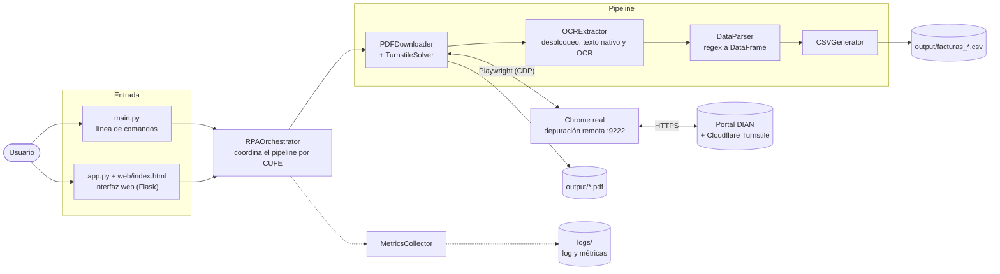

# rpa-cufe

Prueba técnica IQ Outsorsing 26-10-2026 cargo Analista de Innovación

RPA en Python que consulta facturas electrónicas por CUFE en el portal de la DIAN, descarga la representación gráfica en PDF, extrae su texto y consolida los datos en un CSV, reportando métricas y tiempos del proceso.

> **Alcance:** MVP para demostración técnica. Se validó de punta a punta con 5 facturas reales de la DIAN (5 de 5 descargadas y parseadas). No incluye pruebas automatizadas.

## Contenido

- [rpa-cufe](#rpa-cufe)
  - [Contenido](#contenido)
  - [Enunciado](#enunciado)
  - [Cómo funciona](#cómo-funciona)
  - [Arquitectura](#arquitectura)
  - [Stack tecnológico y dependencias](#stack-tecnológico-y-dependencias)
  - [Requisitos](#requisitos)
    - [Instalar Tesseract (opcional)](#instalar-tesseract-opcional)
  - [Instalación](#instalación)
    - [Linux y macOS](#linux-y-macos)
  - [Uso](#uso)
    - [Paso 1: abrir Chrome para el RPA](#paso-1-abrir-chrome-para-el-rpa)
    - [Paso 2: ejecutar, con la interfaz web o por línea de comandos](#paso-2-ejecutar-con-la-interfaz-web-o-por-línea-de-comandos)
      - [Opción A: interfaz web](#opción-a-interfaz-web)
      - [Opción B: línea de comandos](#opción-b-línea-de-comandos)
  - [Resultados](#resultados)
    - [Tiempos y métricas](#tiempos-y-métricas)
  - [Sobre el Captcha (Cloudflare Turnstile)](#sobre-el-captcha-cloudflare-turnstile)
  - [Solución de problemas](#solución-de-problemas)
  - [Estructura del proyecto](#estructura-del-proyecto)
  - [Proceso de desarrollo](#proceso-de-desarrollo)
  - [Limitaciones conocidas](#limitaciones-conocidas)

## Enunciado

1. Construye un RPA que ingrese a la página de la DIAN, consulte los siguientes códigos únicos de facturación CUFE y descargue los PDF de la representación gráfica de cada factura. Ten presente que la página tiene Captcha y tu proceso automatizado lo debe resolver.

   https://catalogo-vpfe.dian.gov.co/User/SearchDocument

   CUFES (prueba):

1. eccc372e4bdb8125cf2e896b405ddb91918c7c6d92238892e3b36bd3b6a86929a3c47ed18ae8f559a1bf51b89ab560f1
2. 8e7b821b46445807245ad6c223d6a054923cea3e5dc59983e55a40cfeac2a4f570eccb198446b27d15c8d834c2e2ced9
3. 6a7ec741dd95ff7f5240481b3ed287f85eea3b665a8b26b91b376095f9bb134d2397ec96586fd16e116ef247a6506770
4. c2e740942c1925d57f2e82254f21992cbad461a0df57fd42a1475fbe71ba5ab68a824c03487cbc19e80c50e436dd30fe
5. 3e6331e537f08a54ec2d9f38904afaae80b16ffa502a12fd9aba388048d50d76b311809be9236aaa1bd1cc781a9d87f3
6. f639eb72baf2e301eddde8e8e5087295831a12c781d4cf6b4671932cdfa3599223aa3375af807a1f5d66aa1543c9fb91
7. 2a90ab2ce6b54e505fc9f463bffb528244abef80d9ab1a9a39d771169c7cfe52b9a48b6feab1fdceb8b4b59ff6e319db
8. 341a447c4891f8e302771bf6a6d95d7011e72d44a8cb670356cbb5e92549824eb0071c542261d837978cfd351d2131d1
9. bbed883f80308e0e0e16e52a1286d71274b1a78419875458c590fcec41c065eda762aaef478775dc219de3c5e2d6400b
10. 70d1aab6f793d4fc7151d69400138cf1bd147e54aaeaf274072898f9d12d979e86e8de79fef27668896db76589323ad0
   

Usar NIT enviado en la prueba 90015**** 

2. Crea un procedimiento para extraer el texto de las imágenes que acabas de exportar. Debes crear un data frame para cada archivo y exportar los datos en un archivo csv. Las variables que debes extraer son:

   - De las secciones "Datos del Documento" y "Datos del Emisor/Vendedor": Número de factura, Fecha de emisión, NIT del emisor.
   - De la tabla en "Detalles del Producto": Código, Descripción, Cantidad, Precio unitario.

   - Reporta los tiempos empleados, restricciones y métricas del proceso.

## Cómo funciona

Para cada CUFE, el sistema ejecuta este pipeline y, si algo falla, lo registra y continúa con el siguiente:

1. **Descarga** (`PDFDownloader` + `TurnstileSolver`)
   1. Abre el portal y resuelve el Cloudflare Turnstile de la página de búsqueda.
   2. Escribe el CUFE y el NIT y pulsa **Buscar**.
   3. Resuelve el segundo Turnstile de la página de la factura.
   4. Pulsa **Descargar PDF**, acepta el modal que avisa que el archivo tiene contraseña y guarda el PDF en `output/`.
   5. Pulsa **Volver** para dejar el portal en la página de consulta, listo para el siguiente documento.
   
   Reintenta hasta 3 veces ante errores de red o de descarga.
2. **Extracción** (`OCRExtractor`): el PDF de la DIAN viene protegido con el NIT como contraseña. Se desbloquea con `pypdf`, se extrae el texto nativo con PyMuPDF y, solo si hay menos de 50 caracteres (PDF escaneado), se recurre a OCR con Tesseract.
3. **Parsing** (`DataParser`): con regex extrae número de factura, fecha de emisión (normalizada a `YYYY-MM-DD`), NIT del emisor y una fila por producto, y arma un DataFrame de pandas por factura.
4. **Consolidación** (`CSVGenerator`): une los DataFrames de todas las facturas en un CSV con timestamp.
5. **Métricas** (`MetricsCollector`): cuenta éxitos y fallos por fase, lista los CUFEs fallidos con su fase y error, y mide el tiempo total.

## Arquitectura



| Capa | Módulos | Responsabilidad |
|---|---|---|
| Entrada | `main.py`, `app.py`, `web/` | Reciben el NIT y los CUFEs, lanzan la ejecución y muestran el resultado |
| Orquestación | `rpa_orchestrator.py` | Único que conoce el flujo: recorre los CUFEs, llama a cada componente y registra métricas por fase |
| Servicios | `turnstile_solver.py`, `pdf_downloader.py`, `ocr_extractor.py`, `data_parser.py`, `csv_generator.py`, `metrics.py` | Cada uno resuelve una sola tarea y no conoce a los demás |
| Transversal | `config.py`, `exceptions.py`, `logging_config.py` | Timeouts, selectores y URL, jerarquía de errores y logging |

Decisiones de diseño:

- **Fallos aislados.** Un error en un CUFE se registra con su fase (descarga, extracción o parsing) y el lote continúa con el siguiente.
- **Reintentos solo donde sirven.** `tenacity` reintenta errores transitorios de red o descarga, no los deterministas (por ejemplo, un enlace que no existe).
- **Chrome real en lugar de uno lanzado por el RPA.** Cloudflare rechaza el navegador que lanza Playwright, así que el RPA se conecta por depuración remota a un Chrome abierto por el usuario.
- **La interfaz web no duplica lógica.** Ejecuta el mismo orquestador en un hilo y la página consulta el estado cada 1,5 s.

## Stack tecnológico y dependencias

| Capa | Tecnología |
|---|---|
| Lenguaje | Python (probado con 3.14; requiere 3.10 o superior) |
| Automatización del navegador | Playwright (API síncrona) sobre Google Chrome real |
| Lectura de PDF | PyMuPDF, pypdf y Tesseract OCR (opcional) |
| Datos | pandas, CSV en UTF-8 |
| Interfaz | CLI con `argparse`; web con Flask y HTML, CSS y JavaScript sin librerías ni compilación |
| Resiliencia y trazabilidad | `tenacity` para reintentos, `logging` para registro y métricas propias en JSON |

Dependencias directas, las de `requirements.txt` (que fija solo versiones mínimas con `>=`):

| Paquete | Versión probada | Para qué se usa |
|---|---|---|
| `playwright` | 1.64.1 | Automatiza el navegador y se conecta a Chrome por depuración remota |
| `playwright-stealth` | 2.0.3 | Parches anti-detección, solo cuando el RPA lanza su propio navegador |
| `PyMuPDF` (módulo `fitz`) | 2.0 | Texto nativo del PDF y renderizado de páginas para OCR |
| `pypdf` | 6.21.2 | Detecta y desbloquea los PDFs protegidos con el NIT |
| `cryptography` | 50.0.2 | Necesaria para que `pypdf` abra PDFs con cifrado AES |
| `pytesseract` | 0.3.13 | Interfaz con Tesseract para el OCR de respaldo |
| `pandas` | 3.1.0 | Un DataFrame por factura y el CSV consolidado |
| `tenacity` | 9.2.1 | Reintentos con espera exponencial |
| `flask` | 3.1.3 | Servidor de la interfaz web |

Dependencias que llegan solas: `Pillow` 13.0.0 (imágenes para el OCR, la instala `pytesseract`) y `numpy` 2.5.4 (la instala `pandas`). Fuera de `pip` se necesitan Google Chrome y, de forma opcional, Tesseract.

## Requisitos

| Requisito | Detalle |
|---|---|
| Sistema operativo | Windows 10/11 (el lanzador `iniciar_chrome.bat` es para Windows; ver [Linux y macOS](#linux-y-macos)) |
| Python | 3.10 o superior |
| Google Chrome | Instalado, para el modo recomendado (`--connect-chrome`) |
| Tesseract OCR | **Opcional.** Solo se usa si un PDF no trae texto nativo. Los PDFs de la DIAN suelen traerlo |
| Un CUFE y el NIT | El NIT del emisor o del receptor de la factura. También es la contraseña del PDF |

### Instalar Tesseract (opcional)

**Windows:** descarga el instalador de https://github.com/UB-Mannheim/tesseract/wiki, marca **Spanish** en *Additional language data* y agrega `C:\Program Files\Tesseract-OCR` al `PATH` (o usa `--tesseract-path`).

**Linux (Debian/Ubuntu):** `sudo apt install tesseract-ocr tesseract-ocr-spa`

**macOS:** `brew install tesseract tesseract-lang`

Verifica con `tesseract --list-langs` que aparezca `spa`.

## Instalación

Desde la carpeta del proyecto, en **PowerShell**:

```powershell
# 1. Crear el entorno virtual
python -m venv venv

# 2. Instalar las dependencias
.\venv\Scripts\python.exe -m pip install -r requirements.txt

# 3. Instalar el navegador de respaldo de Playwright
.\venv\Scripts\python.exe -m playwright install chromium
```

Los comandos de este instructivo usan `.\venv\Scripts\python.exe` directamente, así que no hace falta activar el entorno virtual (que PowerShell a veces bloquea por política de ejecución).

> **Terminal:** usa PowerShell o `cmd`. En una terminal Bash (Git Bash, MSYS2) las rutas con `\` no funcionan: escribe `./venv/Scripts/python.exe` y ejecuta el lanzador con `cmd //c iniciar_chrome.bat`.

### Linux y macOS

Reemplaza `.\venv\Scripts\python.exe` por `./venv/bin/python`. Como `iniciar_chrome.bat` es solo para Windows, abre Chrome con el equivalente:

```bash
google-chrome --remote-debugging-port=9222 --user-data-dir=./chrome-profile \
  https://catalogo-vpfe.dian.gov.co/User/SearchDocument
```

## Uso

### Paso 1: abrir Chrome para el RPA

Haz doble clic en [iniciar_chrome.bat](iniciar_chrome.bat), o ejecútalo desde PowerShell con `.\iniciar_chrome.bat`.

Se abre un Chrome con el portal de la DIAN. **Déjalo abierto mientras corre el RPA.** Por qué es necesario se explica en [Sobre el Captcha](#sobre-el-captcha-cloudflare-turnstile).

### Paso 2: ejecutar, con la interfaz web o por línea de comandos

#### Opción A: interfaz web

```powershell
.\venv\Scripts\python.exe app.py
```

Abre **http://127.0.0.1:8000** en el navegador. Debe abrirse desde esa dirección y no desde el archivo `web/index.html` directamente ni con una extensión como Live Server.

1. Escribe el **NIT**.
2. Pega los **CUFEs**, uno por línea. Los duplicados se eliminan y se avisa si alguno tiene un formato inusual (un CUFE suele tener 96 caracteres hexadecimales).
3. Marca **Usar mi Chrome**. Deja **headless** desmarcado.
4. Pulsa **Ejecutar**.

Verás el progreso de cada CUFE (en espera, procesando, listo o falló, con la fase y el error) y, al terminar, las métricas, una vista previa de los datos y el botón para descargar el CSV. El NIT y los CUFEs se guardan en `data/registro.json` (ignorado por git).

Solo escucha en `127.0.0.1` y procesa una ejecución a la vez. Para detenerlo, pulsa `Ctrl+C` en la terminal.

#### Opción B: línea de comandos

Crea un archivo con un CUFE por línea (ver [example_cufes.txt](example_cufes.txt), cuyos valores son de relleno) y ejecuta:

```powershell
.\venv\Scripts\python.exe main.py --input-file cufes.txt --nit 900156264 --connect-chrome
```

| Argumento | Requerido | Descripción |
|---|---|---|
| `--input-file` | Sí | Archivo con un CUFE por línea |
| `--nit` | Sí | NIT para la consulta en el portal y para desbloquear los PDFs |
| `--connect-chrome` | No | Conectarse al Chrome abierto con `iniciar_chrome.bat`. **Recomendado**: sin él, Cloudflare suele rechazar la verificación |
| `--output-dir` | No | Carpeta de salida para PDFs y CSV (default: `./output`) |
| `--headless` | No | Navegador sin interfaz. **No funciona**: el portal lo bloquea |
| `--tesseract-path` | No | Ruta a Tesseract si no está en el `PATH` |

Al terminar, la consola muestra el tiempo total, las descargas y extracciones exitosas y fallidas, y los CUFEs que fallaron.

## Resultados

Todo queda en la carpeta del proyecto:

| Archivo | Contenido |
|---|---|
| `output/<CUFE>.pdf` | PDF original descargado. **Está protegido: su contraseña es el NIT** |
| `output/<CUFE>_unlocked.pdf` | La misma factura ya desbloqueada. Ábrela si quieres revisarla sin contraseña |
| `output/facturas_YYYYMMDD_HHMMSS.csv` | Datos consolidados, una fila por producto |
| `logs/metrics_YYYYMMDD_HHMMSS.json` | Métricas de la ejecución (solo con la línea de comandos; la interfaz web las muestra en pantalla) |
| `logs/rpa_cufe.log` | Log detallado |
| `logs/turnstile_timeout_*.png`, `logs/descarga_fallo_*.png` | Capturas que se guardan cuando falla el Turnstile o no aparece el enlace de descarga |

Los archivos con nombre tipo `2edc2273-024d-…` que Chrome muestra en su historial de descargas son copias temporales de Playwright en `%TEMP%`. No son el resultado del RPA y puedes ignorarlos.

Columnas del CSV: `cufe`, `numero_factura`, `fecha_emision`, `nit_emisor`, `codigo_producto`, `descripcion_producto`, `cantidad`, `precio_unitario`. Ejemplo, con la factura de prueba:

```
cufe,numero_factura,fecha_emision,nit_emisor,codigo_producto,descripcion_producto,cantidad,precio_unitario
eccc372e…560f1,FEBQ-243564,2024-11-05,800033723,0,MAMOGRAFIA UNILATERAL O PIEZA QUIRURGICA,1.0,75000.0
```

### Tiempos y métricas

Las métricas incluyen tiempo total, descargas, extracciones y resoluciones de Turnstile (éxitos, fallos y tasa) y la lista de CUFEs fallidos con su fase y error.

Referencia de una ejecución real con 5 CUFEs y Chrome conectado:

| Medida | Resultado |
|---|---|
| CUFEs procesados | 5 de 5 sin fallos |
| Tiempo total | 110 s |
| Tiempo por CUFE | entre 15 y 23 s, la mayor parte esperando los dos Turnstile |
| Datos extraídos | 5 facturas, 11 filas de productos, sin valores nulos |

## Sobre el Captcha (Cloudflare Turnstile)

El portal usa Cloudflare Turnstile en la página de búsqueda y de nuevo en el detalle de la factura. Se resuelve **sin servicios de pago**, pero con una restricción importante:

**Cloudflare rechaza el navegador que lanza Playwright.** En las pruebas, el widget se marcaba pero respondía "La verificación falló", incluso cuando una persona pulsaba el checkbox en esa ventana. En un Chrome normal, el mismo widget se resuelve solo.

Por eso el RPA se conecta a un Chrome real abierto por el usuario (`iniciar_chrome.bat`, con depuración remota en el puerto 9222 y un perfil propio en `chrome-profile/`):

- Trabaja en una sola pestaña de ese Chrome y no cierra tu navegador.
- Espera unos segundos a que Turnstile se resuelva solo y, si no ocurre, pulsa el checkbox con movimientos de mouse graduales.
- Si el Turnstile no se resuelve en 60 s, guarda una captura en `logs/` y marca el CUFE como fallido.

Sin `--connect-chrome`, el RPA lanza su propio Chrome (con `playwright-stealth`, sin User-Agent forzado y con ventana visible), pero Cloudflare suele rechazarlo.

## Solución de problemas

| Síntoma | Causa y solución |
|---|---|
| `No se pudo conectar a Chrome en http://127.0.0.1:9222` | Chrome no está abierto con depuración remota. Ejecuta `iniciar_chrome.bat` y vuelve a intentar |
| La interfaz web muestra `Error 404` al consultar el estado | La página se abrió desde otro servidor o desde el archivo. Abre `http://127.0.0.1:8000` con `app.py` en ejecución |
| `La verificación falló` en el widget de Cloudflare | Se está usando el navegador lanzado por el RPA. Usa `--connect-chrome` / la casilla **Usar mi Chrome** |
| `Solicitud bloqueada por controles de seguridad` | El portal bloquea el modo headless. Ejecuta con ventana visible |
| `Error Turnstile: … no se resolvió después de 60s` | Mira la captura `logs/turnstile_timeout_*.png`. Prueba que el captcha pase en tu Chrome normal; puede ser tu red, una VPN o un antivirus que inyecta scripts en la página |
| `No se encontró el enlace 'Descargar PDF'` | La factura no cargó o el portal cambió. Revisa `logs/descarga_fallo_*.png` y el log, que lista los enlaces encontrados |
| Falla en la fase `parsing` y el CSV sale con solo encabezados | El PDF tiene un formato distinto al esperado. Abre `output/<CUFE>_unlocked.pdf` y revisa los patrones de `src/data_parser.py` |
| `tesseract is not installed or it's not in your PATH` | Solo aparece con PDFs sin texto nativo. Instala Tesseract (ver [Requisitos](#requisitos)) |
| `ModuleNotFoundError` al ejecutar | Se está usando otro Python. Usa `.\venv\Scripts\python.exe` e instala `requirements.txt` ahí |
| En Bash: `command not found` con `.\venv\Scripts\python.exe` | Bash trata `\` como escape. Usa PowerShell o `./venv/Scripts/python.exe` |

## Estructura del proyecto

```
.
├── main.py                  # CLI
├── app.py                   # Interfaz web local (Flask)
├── web/index.html           # Página de la interfaz
├── iniciar_chrome.bat       # Abre Chrome con depuración remota para el RPA
├── example_cufes.txt        # CUFEs de ejemplo (relleno)
├── requirements.txt
├── src/
│   ├── config.py            # Timeouts, URL del portal, config de navegador/OCR/logs
│   ├── exceptions.py        # Jerarquía de excepciones
│   ├── logging_config.py    # Logging a archivo y consola
│   ├── turnstile_solver.py  # Resolución de Cloudflare Turnstile
│   ├── pdf_downloader.py    # Navegación del portal y descarga de PDFs
│   ├── ocr_extractor.py     # Desbloqueo del PDF, extracción nativa y OCR
│   ├── data_parser.py       # Regex y DataFrame por factura
│   ├── csv_generator.py     # CSV consolidado
│   ├── metrics.py           # Contadores y resumen de métricas
│   └── rpa_orchestrator.py  # Coordina el pipeline completo
├── data/                    # Registro de la interfaz web (ignorado por git)
├── chrome-profile/          # Perfil del Chrome del RPA (ignorado por git)
├── output/                  # PDFs y CSV (ignorado por git)
└── logs/                    # Logs, métricas y capturas (ignorado por git)
```

## Proceso de desarrollo

1. **Especificación y plan.** Se definieron requisitos, diseño y un plan de 8 tareas (setup, excepciones y configuración, solver de Turnstile y descargador, extracción y parser, CSV y métricas, orquestador y CLI, documentación y prueba manual). Quedaron en `.kiro/specs/rpa-cufe-dian/`.
2. **MVP modular.** Se construyó un componente por responsabilidad y un orquestador que los une, priorizando que el flujo funcionara de punta a punta.
3. **Interfaz web.** Se añadió después, para registrar los CUFEs y el NIT y ejecutar sin usar la terminal.
4. **Validación contra el portal real.** Varios supuestos del diseño inicial resultaron incorrectos y se corrigieron al probar con el portal de la DIAN:

   | Supuesto inicial | Lo que se encontró | Cambio |
   |---|---|---|
   | Esperar a que la red quede inactiva (`networkidle`) | Nunca ocurre: el portal mantiene peticiones abiertas | Esperar `domcontentloaded` y la navegación real tras cada clic |
   | Selectores deducidos del diseño (`PartitionKey`, `DownloadPDF`, `type="submit"`) | No coinciden con la página | Se leyó el DOM real: `#SearchDocumentNit`, `button.search-document`, enlace por su texto |
   | `playwright-stealth` basta para el Turnstile | Cloudflare rechaza el Chrome que lanza Playwright, aunque una persona pulse el checkbox | Conectarse por depuración remota a un Chrome real (`iniciar_chrome.bat`) |
   | El enlace descarga el PDF directamente | Abre un modal y el PDF viene protegido con el NIT | Aceptar el modal y desbloquear con `pypdf` y `cryptography` |
   | Regex genéricos para la tabla de productos | Una celda por línea, números colombianos y dos diseños distintos | Parser de la tabla celda por celda, con las líneas crudas del PDF |
   | El modo headless sirve | El portal lo bloquea | Ejecutar siempre con ventana visible |

5. **Pruebas.** No hay una suite automatizada. La validación fue manual con 5 CUFEs reales, apoyada durante el desarrollo en simulaciones locales puntuales del portal.

## Limitaciones conocidas

- **Validado con 5 facturas reales.** El flujo completo (Turnstile, formulario, modal, descarga, desbloqueo, parsing y CSV) funcionó con 5 CUFEs de distintos emisores, con 1 a 6 productos cada uno. Otros documentos pueden revelar casos no contemplados.
- **El parser depende del formato del PDF.** Está calibrado con la "Representación Gráfica" que genera la DIAN, donde cada celda de la tabla sale en su propia línea y los números usan formato colombiano (`75.000,00`). Cubre los dos diseños vistos en las pruebas: el código del producto en su propia celda o en la misma línea que el inicio de la descripción. Si la celda del código viene vacía, la fila puede desalinearse. El texto obtenido por OCR no se parseó con este formato.
- **Turnstile no está garantizado.** Aun conectado a un Chrome real, Cloudflare puede rechazar la verificación según la red o el equipo. Los CUFEs que fallan quedan en la lista de fallidos.
- **No funciona en modo headless.** El portal bloquea ese modo.
- **Los selectores del portal pueden cambiar.** Los textos y campos que usa el RPA (`#DocumentKey`, `#SearchDocumentNit`, `button.search-document`, "Descargar PDF", "Aceptar", "Volver") están en `src/pdf_downloader.py`.
- Procesamiento secuencial, un CUFE a la vez.
- Sin pruebas automatizadas; la validación es manual con CUFEs reales.
